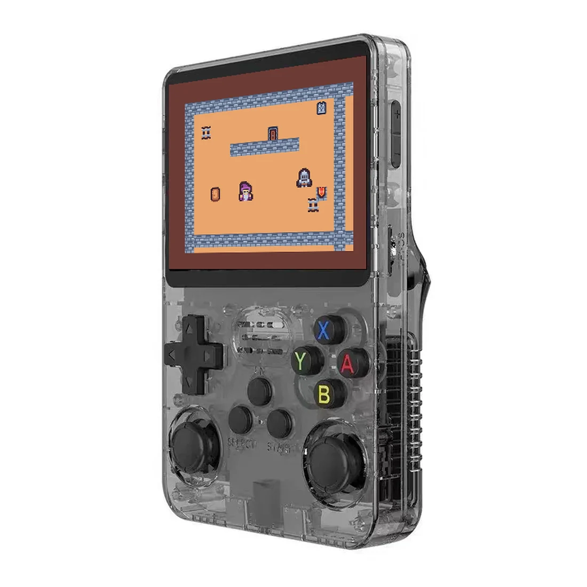

# TreeOS

English | [简体中文](README.zh-CN.md)

**A mainline Linux system for the R36S handheld.** Linux 6.15.6 (on hardware; 6.12 rollback available), Debian 13, open panfrost GPU driver, our own DSI panel driver — built so the device can follow upstream instead of being pinned to a 2016 vendor kernel.



## Why this exists

The R36S ships with a Linux 4.4 vendor kernel (2016) and an Ubuntu 19.10 userland that stopped receiving updates in 2020. Its glibc is frozen at 2.30, so current software — Ruffle, browsers, modern toolchains — refuses to install. The hardware is fine; the base is not.

TreeOS replaces the base:

| Layer | Vendor system | TreeOS |
|---|---|---|
| Kernel | 4.4.189 (2016 BSP) | **mainline 6.15.6** (6.12 rollback) |
| Userland | Ubuntu 19.10, glibc 2.30 | **Debian 13** |
| GPU | closed Mali blob | **panfrost / Mesa 25** (GL ES 3.1) |
| Display | vendor panel driver | **our own DSI panel driver** |
| Frontend | EmulationStation | EmulationStation (kept) |
| Emulator | vendor RetroArch (RGA-dependent) | **Debian RetroArch 1.20** |

## Preview image (0.1.2)

**[Download TreeOS 0.1.2 (R36S)](https://github.com/metahubaifeel/treeos/releases/tag/v0.1.2)**
— 16 GiB image, ~1.7 GB compressed (1,695,814,382 bytes); R36S only (RK3326, 1 GB).

- **Preview: author-side cold-boot regression on real hardware is still pending**
- No ROMs/SWFs/BIOS/saves included; put games in `EASYROMS/import/` or the platform folders
- **Security**: SSH disabled by default, root login disabled, root locked; user `tree`.
  `sudo treeos-ssh on` opens a 10-minute pairing window (random password); `--key` is key-only.
  The window closes and credentials are deleted automatically. See `SECURITY.txt`.

## What works (verified on hardware)

- Boots to a Chinese EmulationStation menu on the R36S panel
- Audio: speaker, headphones, automatic switching
- **Merged gamepad at the kernel layer** — `odroidgo3-joypad` (GPL-2.0) ported from
  Arch R v3.0.3 combines the ADC stick and GPIO buttons into one `r36s_Gamepad`
  (ABS ±1800, 17 standard keys); ES and RetroArch use it directly, no userspace bridge
- RetroArch 1.20: GBA defaults to `mgba` (the `gpsp` core exits immediately on this unit)
- Flash: enhanced (Weston + Ruffle desktop) and classic (frozen core) runtimes;
  Gold Miner, BvS 2.6, Zaomeng Xiyou and Zombie Crisis 3 playable;
  new settings UI: mouse buttons, 2-second hold-to-bind, multi-key per pad button (`south=74,32`)
- Game importer: files dropped in `/roms/import/` are sorted by extension before ES starts;
  arcade zips are kept as-is
- zram swap, WiFi, 21 rotating boot images
- 0.1.2 image published; real-card cold-boot regression still pending

Not verified yet: cold boot of the 0.1.2 image, N64/PSP performance,
save reliability across repeated power cycles, RK3566/RK3562 boards, OTA,
and full Flash playability (per-game validation ongoing).

## Photos and video

- Bleach vs Naruto on the handheld (114 s, end watermark trimmed):
  [assets/video/treeos-bvs-handheld.mp4](assets/video/treeos-bvs-handheld.mp4)
- Stills: [assets/merged-gamepad/](assets/merged-gamepad/)

- Flash runtime and memory findings: `docs/18_Flash运行时与内存.md`
- Ruffle recompilation project: `docs/19_Ruffle重编译项目.md`
- Multi-SoC and ports compatibility review: `docs/08_外部评审-OldBits与多SoC-gpt6luna.md`

- Flash project overview and boundaries: `docs/20_Flash工程总览.md`
- Classic web-game classification: `docs/21_经典页游分类.md`
- Tools and mapping examples: `tools/`

- Hardware facts (R36S, 2GB mod, fan, Wi-Fi module): `docs/hardware/R36S-hardware.md`

## Repository layout

```
docs/     Design notes, failure logs, roadmaps (Chinese; field notes)
kernel/   Kernel config, patches (incl. the Arch R GPL driver port), build script, checksums
dts/      Device tree and the DSI panel driver
scripts/  Image build, backup, flashing helpers
config/   ES/RetroArch input mappings and system config snippets
tools/    Launcher, settings UI and game importer sources (tools/launcher)
devlog/   Dated development notes
assets/   Photos taken on the unit
```

## Building

The kernel is cross-compiled on a Linux host for aarch64:

```bash
# kernel/config-6.12-r36s is the 6.12 baseline; hardware currently runs 6.15.6 v5
# see kernel/build.sh for the toolchain layout
SRC=path/to/linux-6.15.6 bash kernel/build.sh
```

The disk image can be assembled from a running card's rootfs:

```bash
sudo bash scripts/build-image-v3.sh
```

See `docs/12_备份与恢复.md` for the backup and recovery procedure used in development.

## What went wrong (and is written down)

The interesting part of this project is the failure log. A few highlights:

- **Black screen, every core**: the vendor RetroArch links `librga.so.2` and copies frames with Rockchip's private 2D blitter; mainline has no RGA driver. Replaced the emulator, not the core.
- **Two devices, one player**: the analog stick (`adc-joystick`) and buttons (`gpio-keys`) were separate input devices that SDL/RetroArch would not merge. First bridged in userspace (`padmerge.py`), then fixed at the kernel layer by porting `odroidgo3-joypad` from Arch R (GPL-2.0). The userspace bridge is retired.
- **Save file overwritten with empty data**: a 128 KiB save became 0xFF. Root cause not proven; mitigations and the honest write-up are in `docs/11_2026-11-15_踩坑总表.md`.
- **`olddefconfig` without `ARCH`** silently rewrote the kernel config for x86, producing a 25 MB image that boots to a black screen.

The full list, with evidence and commands, is in `docs/11_2026-11-15_踩坑总表.md`.

## Licensing

- Kernel changes, device tree and the ported `odroidgo3-joypad` driver: **GPL-2.0**
- Userspace scripts and documentation: **CC BY-SA 4.0** unless stated otherwise
- Panel driver (`dts/panel-r36s.c`): GPL-2.0
- Third-party provenance and copyright headers: see **THIRD_PARTY_NOTICES.md**

When distributing a kernel binary, the corresponding source is the upstream Linux 6.12
tree plus every patch in `kernel/patches/`, `kernel/config-6.12-r36s` and `dts/`;
the build procedure is in `kernel/build.sh`.

No ROMs, BIOS files, SWF game assets or copyrighted material are distributed here.

## Links

- Shop and hardware notes: <https://r36s.space>
- Development log: <https://r36s.space/devlog>
- Project site: <https://treeos.tech> (coming soon)
