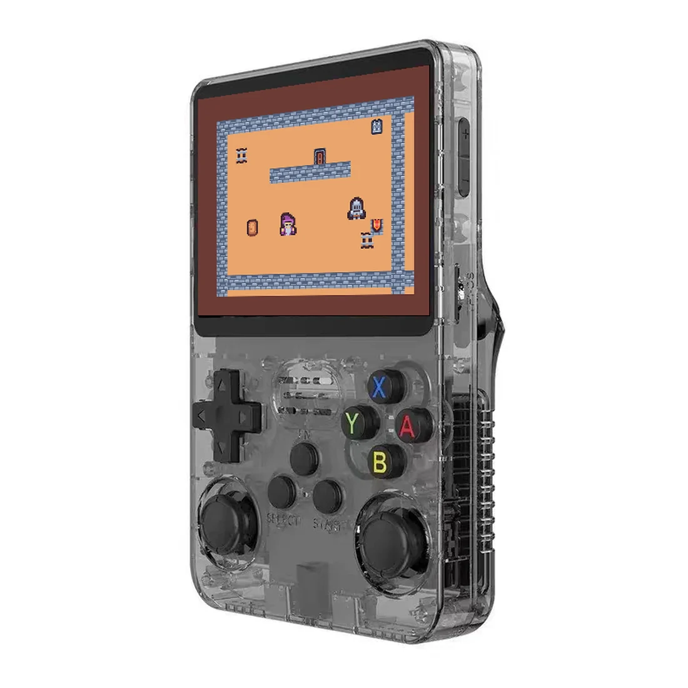

# TreeOS

**给 R36S 掌机的主线 Linux 系统。** Linux 6.12 + Debian 13 + 开源 panfrost GPU 驱动 + 自己写的 DSI 面板驱动——目标是让这台机器能跟着上游走，而不是被锁在 2016 年的厂商内核上。

[English](README.md) | 简体中文



## 为什么做这个

R36S 出厂是 Linux 4.4 厂商内核（2016 年）+ Ubuntu 19.10，2020 年就停止安全更新。它的 glibc 卡在 2.30，Ruffle、浏览器、现代工具链全都装不上。硬件没问题，是地基老了。

TreeOS 换掉地基：

| 层 | 厂商系统 | TreeOS |
|---|---|---|
| 内核 | 4.4.189（2016 BSP） | **主线 6.12** |
| 用户态 | Ubuntu 19.10，glibc 2.30 | **Debian 13** |
| GPU | 闭源 Mali blob | **panfrost / Mesa 25**（GL ES 3.1） |
| 显示 | 厂商面板驱动 | **自己写的 DSI 面板驱动** |
| 前端 | EmulationStation | EmulationStation（保留） |
| 模拟器 | 厂商 RetroArch（依赖 RGA） | **Debian 官方 RetroArch 1.20** |

## 已验证（真机）

- 开机进入中文 EmulationStation 菜单
- 声音：外放、耳机、自动切换
- 按键、十字键、摇杆（摇杆当十字键）、Select+Start 退出
- GBA 游戏运行（gpsp 核心），存档可读可写
- zram、WiFi、21 张开机轮播图
- 16 GiB 可刷写镜像已构建（新卡验收进行中）

尚未验证：N64/PSP 性能、反复开关机后的存档可靠性、其他板型、OTA。

## 仓库结构

```
docs/     设计文档、踩坑记录、路线图（中文）
kernel/   内核配置、补丁、构建脚本、校验值
dts/      设备树 + DSI 面板驱动
scripts/  镜像构建、备份、刷机脚本
devlog/   按日期记录的开发日志
assets/   真机实拍图
```

## 构建

内核在 Linux 主机上交叉编译：

```bash
# kernel/config-6.12-r36s 是真机使用的完整配置
# 工具链布局见 kernel/build.sh
SRC=path/to/linux-6.12 bash kernel/build.sh
```

镜像从运行中的卡的 rootfs 组装：

```bash
sudo bash scripts/build-image-v3.sh
```

备份与恢复流程见 `docs/12_备份与恢复.md`。

## 踩过的坑（都有记录）

- **所有核心都黑屏**：厂商 RetroArch 链接 `librga.so.2`，用 Rockchip 私有 2D 加速器拷帧；主线没有 RGA 驱动。换的是模拟器，不是核心。
- **两个设备，一个玩家**：摇杆（`adc-joystick`）和按键（`gpio-keys`）是两个独立输入设备，SDL/RetroArch 不合并。用虚拟键盘桥（`padmerge.py`）解决。
- **存档被写成空数据**：128 KiB 存档变成全 `0xFF`。根因未证明，缓解措施和完整记录在 `docs/11_2026-11-15_踩坑总表.md`。
- **`olddefconfig` 不带 `ARCH`**：会静默重写成 x86 配置，编出 25 MB 镜像，刷进去黑屏。

完整清单（含证据和命令）见 `docs/11_2026-11-15_踩坑总表.md`。

## 许可

- 内核改动和设备树：**GPL-2.0**（派生自 Linux 内核）
- 用户态脚本和文档：**CC BY-SA 4.0**（另有说明除外）
- 面板驱动（`dts/panel-r36s.c`）：GPL-2.0

本仓库不包含 ROM、BIOS 或版权素材。

## 链接

- 商店与硬件笔记：<https://r36s.space>
- 开发日志：<https://r36s.space/devlog>
- 项目主页：<https://treeos.tech>（即将上线）
