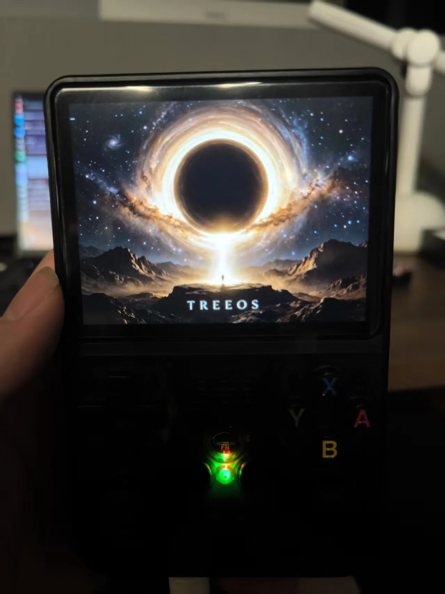

# 2026-11-15: the first image boots a blank card

A 16 GiB TreeOS image written to an empty 128 GB card starts the handheld straight into a Chinese
menu, with no computer and no selector tool.

## The first flash failed

The image checksum matched and dd reported every byte written, yet the handheld showed a black
screen with no backlight. Sector 1 of the card still contained an old GPT header that should have
been zeroed: the write was not clean because the desktop had auto-mounted the card's partitions.

## Clean flash procedure

1. Unmount every partition
2. `wipefs -a /dev/sdX`
3. Zero the first 32 MiB
4. Write the image again
5. Verify two sectors before booting: sector 1 all zeros, sector 64 md5
   `02038d96e902c6fa51541ab1b761d724`

This card writes at about 2.6 MB/s; 16 GiB took roughly 110 minutes.

## Not proven yet, and a release blocker

Only one card and one unit. Game, save, cold boot and power-cycle acceptance remain. The image
also carries the source card's WiFi credentials, SSH keys, shell history and gamelist caches —
these must be stripped before any image is published.
