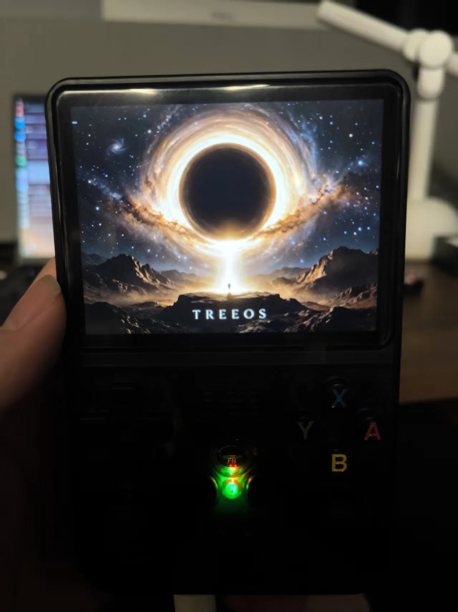
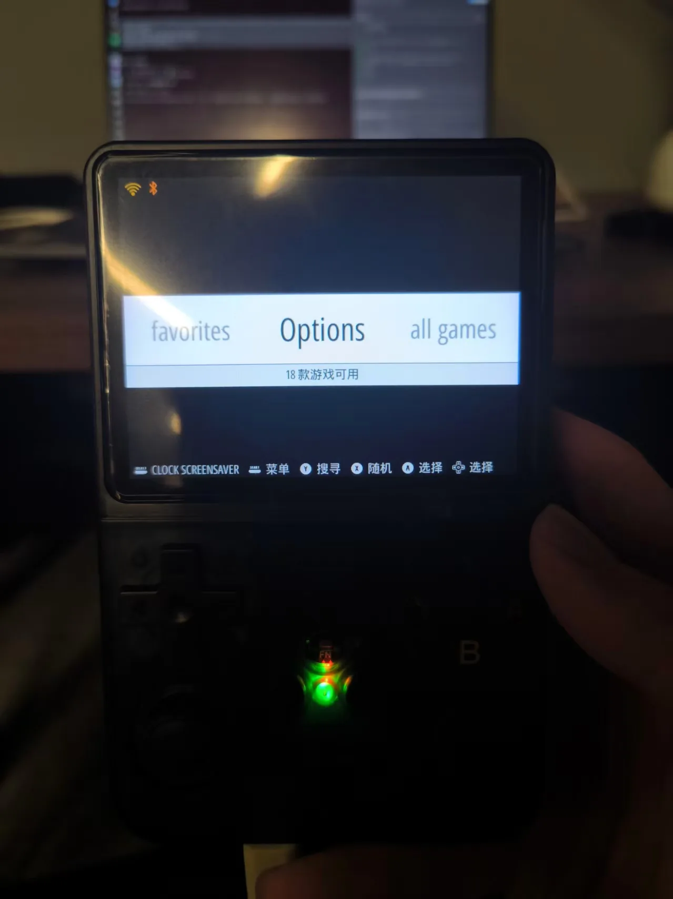

# 2026-11-15：第一张镜像，刷完直接开机

## 结论

16 GiB 的 TreeOS 镜像写入一张空的 128G 卡，插回机器**直接进中文菜单**，
不需要电脑、不需要选择器。这是项目立项以来最重要的一条验证。

## 第一次刷写失败

镜像校验通过，`dd ... conv=fsync` 报告全部写入，但开机**黑屏且无背光**（内核没启动）。

排查发现：卡上第 1 扇区仍残留旧的 **GPT 头**（本该被零覆盖），说明写入没有干净覆盖。
原因是刷写时桌面**自动挂载**了卡上分区，整盘写入与挂载状态冲突。

## 干净刷写流程（以后照这个来）

1. `umount` 所有分区
2. `wipefs -a /dev/sdX`
3. 写 32MiB 零
4. 再次 `dd` 镜像
5. **验证两个扇区**：
   - 第 1 扇区全零（旧分区表已清）
   - 第 64 扇区 md5 = `02038d96e902c6fa51541ab1b761d724`（引导程序与镜像一致）

两项都过再插机器。本机写入速度约 2.6 MB/s，16 GiB 花了约 110 分钟。

## 还没证明的

- 只验证了一张卡、一台机器
- 游戏/存档/冷启动/反复开关机还没跑完
- **v4 必须清除个人数据**：镜像里带着母卡的 WiFi 密码、SSH key、shell 历史、
  gamelist 缓存，公开前必须剥离
